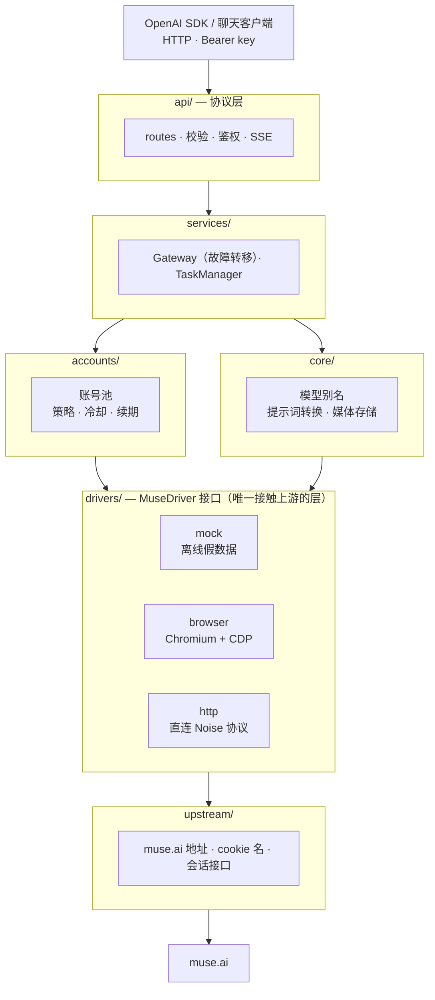

<h1 align="center">muse2api</h1>

<p align="center">
  <a href="README.md">English</a> | <b>中文</b>
</p>

<p align="center">
  一个把 <a href="https://muse.ai">muse.ai</a> 网页应用封装成 <b>OpenAI 兼容 API</b> 的异步网关
</p>

<p align="center">
  
  
  
  
  
</p>

---

## 目录

- [简介](#简介)
- [状态](#状态)
- [架构](#架构)
- [项目结构](#项目结构)
- [快速开始](#快速开始)
- [接口示例](#接口示例)
- [配置](#配置)
- [路线图](#路线图)
- [参与贡献](#参与贡献)
- [免责声明](#免责声明)
- [Star 历史](#star-历史)

## 简介

muse2api 把 muse.ai 的聊天、文生图和文生视频能力变成标准的 OpenAI 接口（`/v1/chat/completions`、`/v1/images/generations` ……）。已有的 OpenAI SDK 和客户端（如 ChatGPT-Next-Web、LobeChat、Cherry Studio）只需改一下 `base_url` 就能用。

项目注重**工程干净和协作友好**：

- **可插拔 driver**：访问上游的方式被抽象在 `MuseDriver` 接口后面。目前有一个 mock driver、一个浏览器（CDP）driver 和一个直连 HTTP/Noise driver。三者完全独立。
- **严格分层**：协议层、服务层、账号池、driver 各司其职，可以单独开发和测试。
- **全异步**：基于 FastAPI + asyncio；CDP 客户端用 `websockets`，没有任何请求会阻塞线程。
- **账号池**：多种调度策略、按账号的并发限制、失败后冷却、过期会话自动剔除、自动故障转移。
- **离线开发**：mock driver 不需要账号、不发任何网络请求，前端和协议层的工作可以独立推进。

## 状态

> **当前**：本地 mock-driver 测试套件通过（无需网络），每次推送到 main 都会跑 CI。直连 HTTP driver 已完成真实账号的文本聊天、图片输入、图片生成/下载和 workspace 文件流程实测。在线视频路径已实现，但测试账号被上游按地区限制，暂时无法实测；浏览器流程仍需实测。

| 模块 | 状态 | 备注 |
|---|---|---|
| OpenAI 协议层（聊天流式/非流式、图片、视频、模型） | ✅ 已实现 | 多轮聊天、system 提示词、图片输入、模型别名 |
| 账号池（调度 / 冷却 / 失效 / 故障转移） | ✅ 已实现 | `lru`、`round_robin`、`affinity` 三种策略 |
| 后台任务（视频） | ✅ 已实现 | 先建任务再轮询结果；重启后未完成的任务会标记为中断 |
| Admin API（账号增删改查、续期、重置、状态） | ✅ 已实现 | 支持 cookie 字典、原始 `Cookie` 请求头字符串、EditThisCookie JSON 三种导入格式，还有批量导入接口 `/admin/accounts/import`；单账号额度快照 `/admin/accounts/{id}/quota` |
| Mock driver | ✅ 已实现 | 离线假数据 |
| 浏览器 driver（Chromium + CDP） | 🧪 待实测 | 聊天、图片、视频全流程已写好 |
| 会话续期 / 保活 | 🧪 待实测 | 纯 HTTP，默认关闭；HTTP token 刷新已实现 |
| 直连 HTTP 协议 driver | ✅ 已实现 | Noise WebSocket、聊天/图片输入/图片生成下载、workspace 文件流程已实测。视频路径已实现，但测试账号被上游按地区限制，无法在线实测。见 [docs/protocol.md](docs/protocol.md) |
| `/v1/images/edits`（参考图） | ✅ 已实现 | 参考图用于生成新图；不支持 `mask` |
| `/v1/responses` | 🚧 预留 | 返回 501 |
| 流式心跳（SSE keepalive） | ✅ 已实现 | 用 `MUSE2API_STREAM_HEARTBEAT_INTERVAL` 开启；等第一个 token 期间发送 `: keepalive` 注释 |
| 媒体自动清理 | ✅ 已实现 | `MUSE2API_MEDIA_RETENTION_DAYS`（默认 14 天，`0` 关闭）；每小时后台清理 |
| 服务端图片抓取的 SSRF 防护 | ✅ 已实现 | 拒绝内网和回环地址 |
| 网页控制台、请求日志、多 API key | ✅ 已实现 | 控制台在 `/dashboard`；key 增删改查在 `/admin/keys`；逐请求日志和统计聚合 |
| 额度查询 | 🧪 待接真 driver | Mock driver 返回假快照；browser/http driver 尚未接入 |
| Cookie 导入浏览器插件 | 🚧 预留 | |
| 存储后端（SQLite / Redis） | 🚧 预留 | 账号仍用 JSON 存储；请求日志已是 SQLite |
| Prometheus 指标 | 🚧 预留 | `/admin/stats` 已有基础聚合 |

## 架构



**一次聊天请求的处理流程**：路由先把模型别名解析好，把多轮 `messages` 合成一条提示词，然后交给 Gateway。Gateway 从账号池租一个账号，调用 driver 要文本流。出错时按错误类型更新账号状态：会话过期的账号下线，额度用完的账号冷却，其他错误短暂冷却。在还没向客户端发送任何内容之前，请求会在另一个账号上重试。

流式请求先拿到第一个 chunk 再返回 200。这样「没有可用账号」「上游鉴权失败」这类错误会以正常的 HTTP 状态码返回，而不是断在流中间。

完整设计见 [docs/ARCHITECTURE.md](docs/ARCHITECTURE.md)，直连 HTTP/Noise 协议见 [docs/protocol.md](docs/protocol.md)。

## 项目结构

```
muse2api/
├── src/muse2api/
│   ├── app.py                 # FastAPI 应用工厂和 lifespan
│   ├── config.py              # 配置（环境变量 / .env）
│   ├── errors.py              # 错误层级 → HTTP 状态码 + OpenAI 错误体
│   ├── api/
│   │   ├── deps.py            # 鉴权和依赖注入
│   │   ├── schemas.py         # OpenAI 请求模型
│   │   └── routes/            # chat / images / videos / media / models / admin / responses
│   ├── services/
│   │   ├── gateway.py         # 在账号池上跑 driver 调用，失败时换账号重试
│   │   ├── tasks.py           # 后台长任务
│   │   └── container.py       # 服务装配
│   ├── accounts/              # 账号模型、JSON 存储、账号池、会话保活
│   ├── core/                  # 模型注册与别名、提示词转换、媒体存储
│   ├── drivers/
│   │   ├── base.py            # MuseDriver 接口与数据类型
│   │   ├── mock.py
│   │   ├── browser/           # cdp.py / chromium.py / dom.py / driver.py
│   │   └── http/              # auth.py / noise.py / events.py / driver.py
│   └── upstream/muse.py       # 上游常量与会话续期
├── tests/                     # mock-driver 与离线协议测试，无网络访问
├── docs/ARCHITECTURE.md · docs/protocol.md
├── TODO.md                    # 贡献者任务板
├── Dockerfile · docker-compose.yml · .env.example
└── CONTRIBUTING.md
```

## 快速开始

### 本地运行

```bash
git clone https://github.com/www222fff/muse2api.git
cd muse2api
python3 -m venv .venv && source .venv/bin/activate
pip install -e '.[dev]'
cp .env.example .env      # 默认 MUSE2API_DRIVER=mock，不需要账号
python -m muse2api        # 默认监听 http://127.0.0.1:18610
```

如果没设置 `MUSE2API_API_KEY`，首次启动会自动生成一个 key 并保存到 `data/api_key`。

### Docker

```bash
cp .env.example .env
docker compose up -d --build
```

### 用真实账号

从已登录 muse.ai 的浏览器导出 cookies。至少需要 `hatch_sess`、`hatch_vml` 和 `hatch_native_auth_device`（旧版导出里可能还有 `hatch_gw`），然后通过下面的 Admin API 示例把账号导进来。

**HTTP driver（不需要 Chromium）**

1. 在 `.env` 里设置 `MUSE2API_DRIVER=http`。默认安装已包含 `curl_cffi`、`cryptography` 和 `zstandard`。
2. 启动服务。它会自动发现 workspace、获取短期 gateway token，并直接打开 Noise WebSocket。
3. driver 会为每个 API 请求创建独立的 muse.ai thread，并在结束后清理上传的参考文件。

**浏览器 driver**

1. 装好 Chromium 或 Chrome，在 `.env` 里设置 `MUSE2API_DRIVER=browser`。
2. 启动服务。浏览器 driver 会使用持久化 profile，并为每个账号创建独立标签页。

## 接口示例

所有 `/v1/*` 接口都需要请求头 `Authorization: Bearer <API_KEY>`。`/admin/*` 接口用 `MUSE2API_ADMIN_KEY`，没设置时默认和 API key 相同。

**聊天（流式）**

```bash
curl http://localhost:18610/v1/chat/completions \
  -H "Authorization: Bearer $KEY" -H "Content-Type: application/json" \
  -d '{"model":"gpt-4o","messages":[{"role":"user","content":"Hello"}],"stream":true}'
```

**OpenAI Python SDK**

```python
from openai import OpenAI

client = OpenAI(base_url="http://localhost:18610/v1", api_key="<API_KEY>")
resp = client.chat.completions.create(
    model="muse-chat",
    messages=[{"role": "user", "content": "Write a short poem about autumn"}],
)
print(resp.choices[0].message.content)
```

**文生图**

```bash
curl http://localhost:18610/v1/images/generations \
  -H "Authorization: Bearer $KEY" -H "Content-Type: application/json" \
  -d '{"prompt":"A cyberpunk street on a rainy night","size":"16:9","response_format":"url"}'
```

**透明背景**

muse.ai 只返回平面的 RGB 图片，所以 `"background":"transparent"` 会在本地把主体抠出来（BiRefNet + 边缘颜色估计）并返回 RGBA PNG。需要 `pip install -e '.[matting]'`；模型（约 930MB）首次使用时会下载到 `~/.u2net`。CPU 上每张图多花约 30 秒。

```bash
curl http://localhost:18610/v1/images/generations \
  -H "Authorization: Bearer $KEY" -H "Content-Type: application/json" \
  -d '{"prompt":"A red fox sitting","background":"transparent"}'
```

**用参考图生成图片**

`"image"` 接受一张参考图或最多 4 张的列表（data URL、http(s) URL 或纯 base64）。参考图会像聊天上传一样附在发往 muse.ai 的消息里，提示词说明用法，例如让模特穿上某件卫衣，或用 "the same fox, now wearing a red scarf" 保持主体和场景。`/v1/images/edits` 用 OpenAI 风格的 multipart 上传做同样的事，所以 `client.images.edit()` 能用；`mask`（局部重绘）不支持。

```bash
curl http://localhost:18610/v1/images/generations \
  -H "Authorization: Bearer $KEY" -H "Content-Type: application/json" \
  -d '{"prompt":"A model wearing exactly this hoodie, studio photo","image":"data:image/jpeg;base64,..."}'

curl http://localhost:18610/v1/images/edits \
  -H "Authorization: Bearer $KEY" \
  -F "image[]=@fox.png" -F "prompt=The same fox, now wearing a red scarf"
```

**异步生成图片**

同步的图片调用（页面加载加生成）可能超过反向代理的超时；Cloudflare 约 100 秒后会返回 HTTP 524。加 `"async": true` 会返回一个任务，再轮询它。结果总是存成媒体 URL。

```bash
curl http://localhost:18610/v1/images/generations \
  -H "Authorization: Bearer $KEY" -H "Content-Type: application/json" \
  -d '{"prompt":"A red fox sitting","async":true}'          # -> {"id":"task_xxx","object":"image.task",...}
curl http://localhost:18610/v1/images/generations/task_xxx -H "Authorization: Bearer $KEY"
```

**文生视频（异步任务）**

```bash
# 建任务，返回 {"id": "task_xxx", "status": "queued", ...}
curl http://localhost:18610/v1/videos \
  -H "Authorization: Bearer $KEY" -H "Content-Type: application/json" \
  -d '{"prompt":"Maple leaves falling in a light breeze","duration":5,"size":"16:9"}'

# 轮询任务；成功后 result.url 指向视频
curl http://localhost:18610/v1/videos/task_xxx -H "Authorization: Bearer $KEY"
```

**导入账号**

```bash
curl http://localhost:18610/admin/accounts \
  -H "Authorization: Bearer $ADMIN_KEY" -H "Content-Type: application/json" \
  -d '{"label":"acc1","cookies":{"hatch_sess":"...","hatch_gw":"...","hatch_vml":"...","hatch_native_auth_device":"..."}}'
```

### 接口一览

| 方法 | 路径 | 说明 |
|---|---|---|
| GET | `/healthz` · `/readyz` | 存活 · 就绪检查（driver 状态和可用账号） |
| GET | `/v1/models` | 模型列表，含 `gpt-4o`、`dall-e-3` 等别名 |
| POST | `/v1/chat/completions` | 聊天，流式和非流式 |
| POST | `/v1/images/generations` · GET `/v1/images/generations/{id}` | 文生图（可选 `image` 参考图），返回 `url` 或 `b64_json`；`"async": true` 返回可轮询的任务 |
| POST | `/v1/images/edits` | multipart `image`/`image[]` 文件 + `prompt`，OpenAI 兼容 |
| POST | `/v1/videos` · GET `/v1/videos/{id}` | 建视频任务 · 查任务 |
| GET | `/v1/media/{name}` | 下载生成的媒体文件 |
| GET/POST/PATCH/DELETE | `/admin/accounts[/{id}]` | 账号增删改查 |
| POST | `/admin/accounts/import` | 账号批量导入，逐条报错 |
| POST | `/admin/accounts/{id}/renew` · `/reset` | 会话续期 · 重置账号状态 |
| GET | `/admin/status` · `/admin/tasks` | 服务状态 · 任务列表 |
| GET/POST/PATCH/DELETE | `/admin/keys[/{id}]` | 客户端 API key（创建时只返回一次明文；PATCH 改名/吊销） |
| GET | `/admin/requests` · `/admin/stats?window=1h\|24h\|7d` | 请求日志（可按 `key_id`、`account_id`、`status=2xx\|4xx\|5xx`、`path`、`since` 过滤，`hide_polls` 隐藏轮询）· 聚合统计 |
| GET | `/dashboard` | 网页控制台（在浏览器里输入 admin key） |
| POST | `/v1/responses` | 预留，目前返回 501 |

### 控制台、API key 与请求日志

打开 `http://localhost:18610/dashboard` 并输入 admin key；key 存在浏览器的 local storage 里，以 Bearer token 发给 `/admin/*`。页面展示请求量、错误率、延迟、账号池（启用/禁用、续期、重置）、实时请求日志和 API key 管理。

除了 admin key 和 `MUSE2API_API_KEY`（仍可用，日志里记为 `legacy`），`/v1/*` 接受任何未被吊销的 key：在控制台或用 `POST /admin/keys {"name": "..."}` 创建。key 长这样 `m2a-...`，只在创建时展示一次；`data/keys.json` 只存它们的 SHA-256 哈希和 8 字符前缀。每个 `/v1/*` 请求（`/v1/media/*` 下载除外）都会记到 `data/requests.db`（SQLite），含 key、模型、账号、状态码、延迟和客户端 IP（识别 `CF-Connecting-IP` / `X-Forwarded-For`）。任务状态轮询会被打标，控制台和统计可以排除它们。

## 配置

所有配置来自环境变量（前缀 `MUSE2API_`）或 `.env` 文件。完整列表见 [.env.example](.env.example)。常用的：

| 变量 | 默认值 | 说明 |
|---|---|---|
| `MUSE2API_DRIVER` | `mock` | driver：`mock` / `browser` / `http` |
| `MUSE2API_HOST` · `MUSE2API_PORT` | `127.0.0.1` · `18610` | 监听地址和端口 |
| `MUSE2API_API_KEY` | 自动生成 | `/v1/*` 接口的 key |
| `MUSE2API_ADMIN_KEY` | 同 API key | `/admin/*` 接口的 key |
| `MUSE2API_REQUEST_LOG_RETENTION_DAYS` | `14` | `data/requests.db` 里保留多少天的请求历史 |
| `MUSE2API_MEDIA_RETENTION_DAYS` | `14` | `data/media` 里生成的媒体文件保留多少天；`0` 关闭自动清理 |
| `MUSE2API_STREAM_HEARTBEAT_INTERVAL` | `0` | 等第一个流式 token 期间 SSE `: keepalive` 注释的发送间隔（秒）；`0` 关闭 |
| `MUSE2API_PUBLIC_BASE` | 空 | 媒体链接的公开 base URL；空时从请求推导 |
| `MUSE2API_POOL_STRATEGY` | `lru` | 账号调度：`lru` / `round_robin` / `affinity` |
| `MUSE2API_MAX_FAILOVER` | `2` | 换账号重试的最大次数 |
| `MUSE2API_ACCOUNT_MAX_CONCURRENCY` | `1` | 每个账号的并行请求数（browser driver：每请求一个 tab）；4 比较好用 |
| `MUSE2API_CHROMIUM_PATH` | 自动探测 | 浏览器可执行文件路径（仅浏览器 driver） |
| `MUSE2API_KEEPALIVE_ENABLED` | `false` | 后台定期续期会话 |
| `MUSE2API_MATTING_MODEL` | `birefnet-general` | `background: "transparent"` 用的抠图模型（`birefnet-general-lite` 更快） |

## 路线图

所有预留模块和未完成的工作都在 **[TODO.md](TODO.md)** 里跟踪，分四组：

- **验证与实测（先做）**：把测试跑通、用真实账号测浏览器 driver、验证在线视频生成和会话续期。
- **Driver**：完善直连 HTTP driver（在线视频与额度查询）、会话复用降低首字延迟。
- **协议层**：`/v1/responses`、mask 局部重绘、仿真 tool calling。
- **账号、管理与运维**：cookie 导入浏览器插件、存储后端、按 key 限流、Prometheus 指标。

每个任务都写了位置、做法和完成标准。代码里标了 `TODO(contributors)` 的地方是预留的扩展点。

## 参与贡献

欢迎从 [TODO.md](TODO.md) 里认领任务。动手前请先开一个 issue 说明你的计划；规范见 [CONTRIBUTING.md](CONTRIBUTING.md)。

```bash
pytest           # mock driver + 离线 HTTP 协议测试
ruff check .     # lint
```

## 免责声明

本项目仅用于学习和技术研究。请遵守 muse.ai 的服务条款和当地法律。切勿提交或公开账号 cookies。

## Star 历史

[](https://star-history.com/#www222fff/muse2api&Date)

## 许可证

[MIT](LICENSE)
