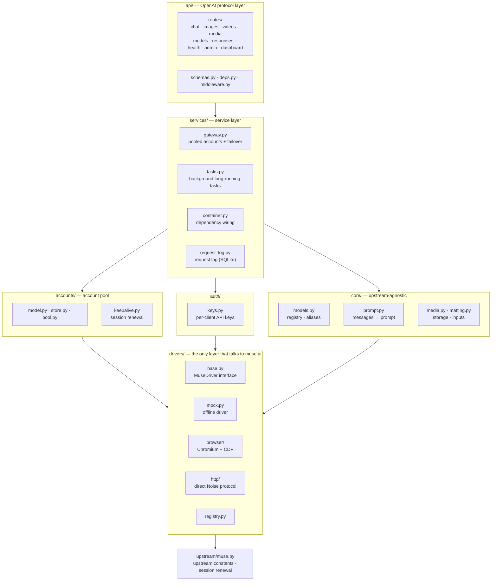

# Architecture

## Layers



Dependencies flow strictly downward: `api → services → accounts/auth/core → drivers → upstream`. Routes never call a driver directly, and drivers know nothing about the HTTP wire format.

## Lifecycle of a chat request

1. `routes/chat.py` validates the request, `resolve_model` resolves aliases, and `flatten_messages` merges the conversation into a single prompt and extracts images.
2. `Gateway.chat_stream` leases an account through `AccountPool.lease()` (chosen by the configured strategy and subject to the per-account concurrency limit).
3. It calls `driver.chat_stream(account, ChatRequest)` and receives text deltas.
4. On failure:
   - `UpstreamAuthError`: the account is marked `invalid`;
   - `UpstreamQuotaError`: the account cools down for at least one hour;
   - any other retryable error: the account cools down for `account_cooldown` seconds;
   - if nothing has been sent to the client yet, the request is retried on another account (up to `max_failover` times).
5. For streaming, the route pulls the first delta before returning 200, so errors such as "no account available" or "upstream authentication failed" come back with the right HTTP status code.

## Driver contract

```python
class MuseDriver(ABC):
    name: str
    requires_account: bool
    capabilities: DriverCapabilities

    async def startup(self) / shutdown(self)
    async def health(self) -> dict
    def chat_stream(self, account, ChatRequest) -> AsyncIterator[str]   # required
    async def generate_image(self, account, ImageRequest) -> list[MediaResult]
    async def generate_video(self, account, VideoRequest) -> MediaResult
    async def renew_session(self, account) -> SessionInfo
    async def quota(self, account) -> dict
```

- Unimplemented capabilities raise `FeatureNotImplemented` (HTTP 501) so the upper layers can degrade gracefully.
- Errors must be mapped to the `Upstream*` types in `errors.py`; the account pool relies on them to decide an account's state.
- Drivers are not responsible for retries, persistence or building URLs.

## Browser driver notes

- One Chromium process. Each account gets its own isolated browser context via `Target.createBrowserContext` (up to `MUSE2API_ACCOUNT_MAX_CONCURRENCY` tabs, one window per tab — Chromium throttles background tabs of a shared window), so switching accounts never requires clearing cookies.
- Follow-up chat from the same owner stays on that conversation and only the new user text is sent. The thread URL is stored on the account, so a later request reopens that muse chat instead of `/thread/new`. A different history or a different `user` opens a fresh page. The default pool strategy is `affinity`.
- All DOM selectors and in-page scripts live in `drivers/browser/dom.py`. When muse.ai changes its UI, this is usually the only file that needs updating.
- Text is written into the textarea through the native value setter plus an `input` event, so React picks it up and long prompts stay fast. If the send button cannot be found, it falls back to pressing Enter.
- Output detection polls the text of the last assistant bubble and emits the new part. The reply is considered finished once the Stop button is gone and the text has stopped changing.
- Media: wait for a new attachment node, then `fetch()` its `blob:` URL inside the page and return the bytes as base64.

## HTTP / Noise driver notes

The HTTP driver replaces the browser with the same protocol the web client uses. It is selected with `MUSE2API_DRIVER=http`; no Chromium is required.

- **Bootstrap**: `auth.py` loads `/thread/new` with `curl_cffi` (Chrome TLS fingerprint), reads the active `gatewayUrl`/`vmName`, and mints a five-minute hatch token at `/api/hatch/token`. Grants are cached per account and keyed by a hash of the cookie values.
- **Transport**: `noise.py` opens `wss://hatch.metaaivm.com/v1/noise` and runs `Noise_XX_25519_AESGCM_SHA256`. HTTP requests and responses are protobuf envelopes inside encrypted WebSocket frames. Unary requests and long-lived NDJSON subscriptions share the same tunnel.
- **Threads**: one isolated thread is created per API call by sending `/chat/stream` with a fresh UUID as `session_id`. The driver subscribes to `/chat/subscribe` immediately and reconciles transient `delta.text_append` events with the final transcript in `delta.message_done`.
- **Media generation**: generated images/videos are delivered as `delta.presentation` cards, usually separately from `message_done`. `events.py` extracts `data.images`/`data.videos`, `image_path`/`video_path` and markdown fallbacks, normalises them to `sandbox://workspace/...`, and the driver downloads them with `/fs/raw/...`.
- **Workspace files**: reference images are uploaded in 512 KiB chunks with `/fs/write`; every upload is deleted in the call's `finally` block. Paths must be relative (`workspace/...`).
- **Error handling**: transport resets/closes and gateway JSON errors are mapped to `Upstream*` errors. A failed handshake invalidates the cached token and retries once; the account pool can still fail over before any client output.
- **Limitations**: the protocol is undocumented and may change. HLS/m3u8 video playlists are not remuxed, quota lookup is not wired yet, and the test account used for live checks is blocked from video generation by an upstream region restriction. See [protocol.md](protocol.md) for the wire format.

## Roadmap

Reserved modules and outstanding work are tracked in [TODO.md](../TODO.md) at the repository root.
